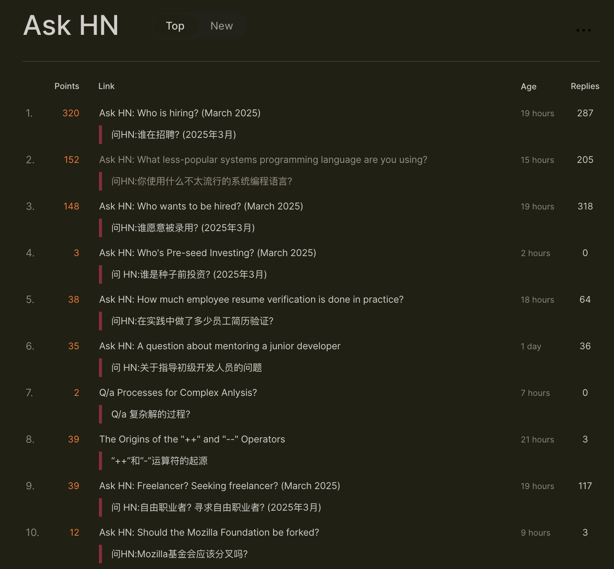
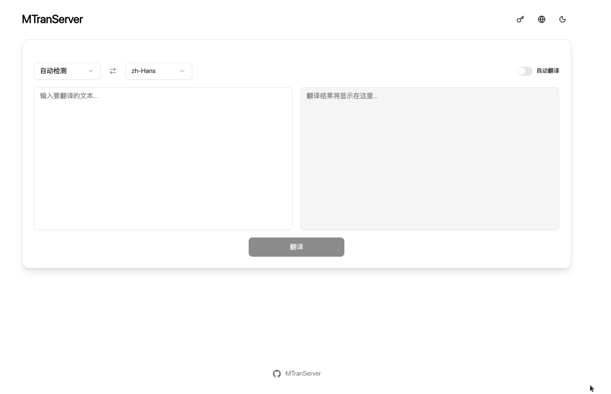
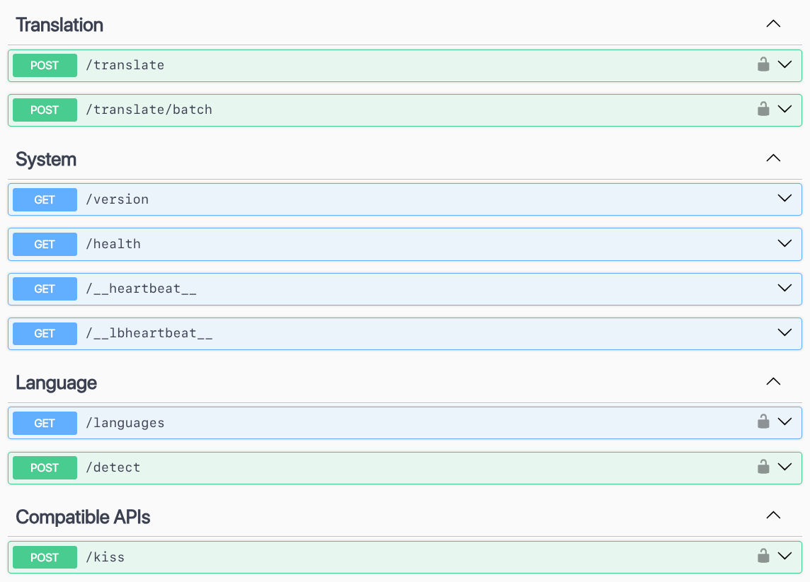

# MTranServer

[中文](README.md) | [English](docs/README_en.md) | [日本語](docs/README_ja.md) | [Français](docs/README_fr.md) | [Deutsch](docs/README_de.md)

在自己电脑上运行的免费离线翻译服务，速度超快⚡，不需要显卡（但也支持显卡加速）。支持多种语言，可搭配浏览器和编辑器插件使用。速度和内存占用取决于电脑配置、语言和文本长度。

适合日常阅读和理解大意。翻译结果可能有误，重要内容请核对原文。推荐搭配具有双语翻译对照功能的软件使用。

> 从 v4 或更早版本升级后，首次使用某个翻译方向时可能需要重新准备翻译文件。



## 在线试用

> 可能不是最新版的模型

| 网站 | TOKEN | 其他接口 | 提供者 |
| --- | --- | --- | --- |
| [ipacel.cc](https://MTranServer.ipacel.cc/ui/?token=__IpacEL_MT_API_TOKEN__) | `__IpacEL_MT_API_TOKEN__` | 沉浸式翻译: `https://MTranServer.ipacel.cc/imme?token=__IpacEL_MT_API_TOKEN__` | [@ApliNi](https://github.com/ApliNi) |

感谢社区贡献者为用户提供试用服务！

## 使用

日常使用建议装桌面端。服务器用 Docker 或命令行。v5 不提供服务端单文件可执行程序。

### 桌面端

从 [Releases](https://github.com/xxnuo/MTranServer/releases) 下载对应平台的安装包，安装后启动。托盘菜单可以管理服务，程序自带简单界面和接口文档。





### 命令行

```bash
npx mtranserver@latest
```

`npx` 可换成 `bunx`、`pnpx` 等。需要常驻时：

```bash
npm i -g mtranserver@latest
mtranserver
```

`npm` 可换成 `bun`、`pnpm` 等。首次翻译某个语言方向时会联网下载并准备文件，之后会复用。建议先翻译一小段确认可用。

### Docker

默认镜像只使用 CPU。在空目录写入 `compose.yml`：

```yml
services:
  mtranserver:
    image: xxnuo/mtranserver:latest
    container_name: mtranserver
    restart: unless-stopped
    ports:
      - "8989:8989"
    environment:
      - MT_HOST=0.0.0.0
      - MT_PORT=8989
      - MT_MODEL_DIR=/app/models
      - MT_CONFIG_DIR=/root/.config/mtran/server
      - MT_OFFLINE=false
      - MT_CPU_ONLY=true
      # - MT_API_TOKEN=your_secret_token_here
    volumes:
      - ./models:/app/models
      - ./config:/root/.config/mtran
```

```bash
docker pull xxnuo/mtranserver:latest
docker compose up -d
```

需要 GPU 时，在本仓库目录使用对应配置。它们依赖宿主驱动，以 WebGPU/Vulkan 推理，不含 CUDA/TensorRT：

```bash
docker compose -f compose.intel.yml up -d   # Intel，映射 /dev/dri
docker compose -f compose.amd.yml up -d     # AMD，映射 /dev/dri
docker compose -f compose.nvidia.yml up -d  # NVIDIA Container Toolkit
```

GPU 配置会按实测选择后端，并保留 CPU 回退。

### 升级与离线

1. 升级前保留原来的配置目录和模型目录。
2. 升级后保持联网，把要用的每个翻译方向试译一次，等文件准备完成。
3. 准备好后可在设置中开启离线模式，或加上 `--offline` / `MT_OFFLINE=true`。离线时只能用已经准备好的方向。
4. 换机器或迁移 Docker 时，配置和模型两个目录都要带走。

上面的 Docker 示例把它们放在当前目录的 `config` 和 `models`。离线部署前先联网准备，再把 `MT_OFFLINE` 改为 `true` 后重启。

## 接入

### 浏览器插件

把下表地址填进插件。超时或机器吃力时，再降低并发和单次长度。

| 接口 | 方法 | 插件 | 地址 |
| --- | --- | --- | --- |
| `/imme` | POST | [沉浸式翻译](https://immersivetranslate.com/) | `http://localhost:8989/imme` |
| `/kiss` | POST | [简约翻译](https://github.com/fishjar/kiss-translator) | `http://localhost:8989/kiss` |
| `/deepl` | POST | 支持 DeepL API v2 的客户端 | `http://localhost:8989/deepl` |
| `/deeplx` | POST | 支持 DeepLX 的客户端 | `http://localhost:8989/deeplx` |
| `/hcfy` | POST | [划词翻译](https://github.com/Selection-Translator/crx-selection-translate) | `http://localhost:8989/hcfy` |
| `/google/language/translate/v2` | POST | 支持 Google Translate API v2 的客户端 | `http://localhost:8989/google/language/translate/v2` |
| `/google/translate_a/single` | GET | 支持 Google 网页翻译的客户端 | `http://localhost:8989/google/translate_a/single` |

设置了 `MT_API_TOKEN` 时：

| 插件 | 填法 |
| --- | --- |
| 沉浸式翻译 | URL 改为 `http://localhost:8989/imme?token=你的令牌` |
| 简约翻译 | URL 仍是 `/kiss`，`KEY` 填令牌 |
| DeepL | `DeepL-Auth-Key` 或 `Bearer` |
| DeepLX、划词翻译 | URL 的 `token` 参数，或 `Bearer` |
| Google Translate API | `key` 参数，或 `Bearer` |

### 其他项目

- [MTranCode](https://github.com/xxnuo/MTranCode)：VS Code、Cursor 等的注释翻译插件，商店搜索 `MTranCode`。默认请求 `http://localhost:8989`。基于 [vscode-comment-translate](https://github.com/intellism/vscode-comment-translate)。
- [MTranBrowser](https://github.com/xxnuo/MTranBrowser)：开发中。
- npm 包 `mtranserver` 也可作为库调用，类型见发布包里的声明文件。

有衍生项目欢迎提 PR，补到这里。

### 常用参数

```bash
mtranserver --help
mtranserver --host 127.0.0.1 --port 8080
mtranserver --download en_zh zh_en
mtranserver --languages
mtranserver --offline
```

| 参数 | 说明 |
| --- | --- |
| `--host` / `--port` | 监听地址和端口，默认 `0.0.0.0:8989` |
| `--ui` / `--no-ui` | 开关网页界面，默认开 |
| `--offline` | 只用已经准备好的翻译文件 |
| `--download <方向...>` | 下载并准备，例如 `en_zh zh_en` |
| `--languages [过滤]` | 列出可下载的方向 |
| `--worker-idle-timeout <秒>` | 空闲后释放引擎，默认 60 |
| `--cache-size <条数>` | 缓存最近译文，默认 1000，`0` 为关闭 |
| `--fast` / `--no-fast` | 启用快速模式，默认关闭；可能增加误译 |
| `--api-token <令牌>` | API 访问令牌 |

环境变量和其余参数见 [API.md](API.md)，或运行 `mtranserver --help`。

## 性能

同一轮 CPU 测试，仅供参考。毫秒越低越好，次/秒越高越好。

| 方向 | 输入 | 并发 | 默认 | Fast | [LinguaSpark](https://github.com/LinguaSpark/server) |
| --- | --- | --- | --- | --- | --- |
| 英 → 中 | 短句 | 1 | 8.8 ms | **7.2 ms** | 10.7 ms |
| 英 → 中 | 段落 | 1 | 32.5 ms | **28.1 ms** | 46.7 ms |
| 中 → 英 | 短句 | 1 | 11.8 ms | **6.5 ms** | 9.9 ms |
| 中 → 英 | 段落 | 1 | 53.0 ms | **29.0 ms** | 48.6 ms |
| 英 → 中 | 长文（32 句） | 1 | 164.2 ms | **120.8 ms** | 482.2 ms |
| 中 → 英 | 长文（32 句） | 1 | 459.1 ms | **159.1 ms** | 580.7 ms |
| 英 → 中 | 短句 | 8 | 273 次/秒 | 401 次/秒 | **491 次/秒** |
| 中 → 英 | 短句 | 8 | 155 次/秒 | 453 次/秒 | **497 次/秒** |

同时加载英中、中英模型后，内存约为：普通 619 MiB、Fast 650 MiB、LinguaSpark 190 MiB。

长文支持句子并发；[配对 HTTP 测试](docs/benchmarks/plain-inference-concurrency.json)中，单个长文请求耗时较优化前降低约 36%–60%。`--fast` 开启 Fast，默认关闭；可能增加误译。[译文对比](tests/fixtures/translation-quality-regressions.json)。

- 桌面场景：推荐普通模式，优先保证翻译准确性；支持 GPU 加速，独显在适合的负载下可能比 CPU 快数倍。
- 服务器场景：推荐 Fast 模式，侧重稳定吞吐与速度，可利用多种 CPU 指令集加速。

## 同类项目

| 项目 | 内存 | 速度 | 说明 |
| --- | --- | --- | --- |
| [NLLB](https://github.com/facebookresearch/fairseq/tree/nllb) | 很高 | 慢 | Android 移植见 [RTranslator](https://github.com/niedev/RTranslator)，仍然占内存 |
| [LibreTranslate](https://github.com/LibreTranslate/LibreTranslate) | 很高 | 中等 | [社区数据](https://community.libretranslate.com/t/performance-benchmark-data/486)：中端 CPU 约 3 句/秒，高端约 15–20 句/秒 |
| [OPUS-MT](https://github.com/Helsinki-NLP/Opus-MT) | 高 | 快 | [CTranslate2 基准](https://github.com/OpenNMT/CTranslate2#benchmarks) |
| 其他大模型 | 超高 | 很慢 | 效果好，硬件要求高；高并发常用 vLLM |
| 本项目 | 随模型和并发变化 | 超快 | CPU 翻译，无缓存状态 |

## 更多

高级配置见 [API.md](API.md) 和启动后的接口文档。

[](https://www.star-history.com/#xxnuo/MTranServer&Timeline)

## Thanks

[Bergamot Project](https://browser.mt/) for the inspiration for local translation.

[ONNX Runtime](https://github.com/microsoft/onnxruntime) for the translation runtime.

[Mozilla](https://github.com/mozilla) for the [models](https://github.com/mozilla/firefox-translations-models).
