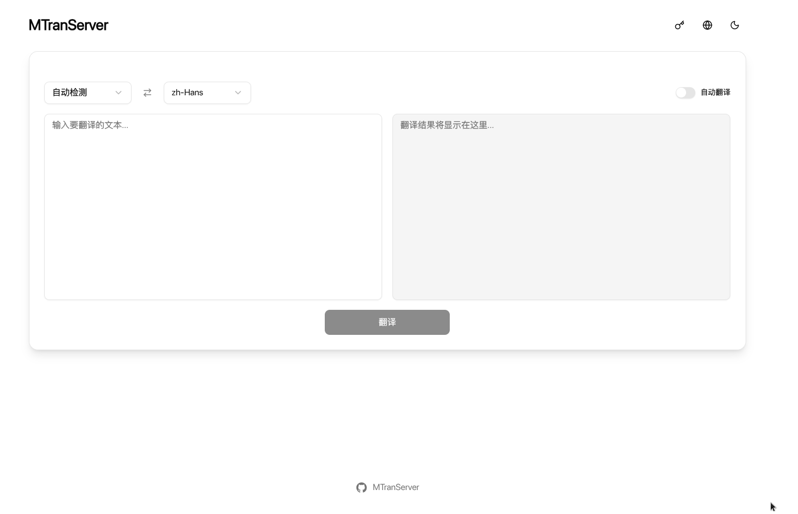
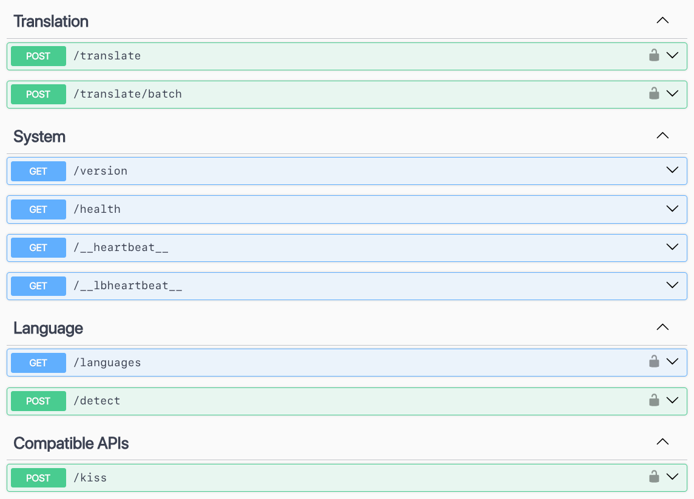

# MTranServer

[中文](../README.md) | [English](README_en.md) | [日本語](README_ja.md) | [Français](README_fr.md) | [Deutsch](README_de.md)

Ein kostenloser Offline-Übersetzungsdienst, der auf dem eigenen Computer läuft. Er ist sehr schnell ⚡, braucht keine Grafikkarte und kann sie zur Beschleunigung trotzdem nutzen. Er unterstützt mehrere Sprachen und lässt sich mit Browser- und Editor-Erweiterungen verwenden. Geschwindigkeit und Speicherbedarf hängen vom Computer, von den Sprachen und von der Textlänge ab.

Geeignet für alltägliches Lesen und das Erfassen des Sinns. Übersetzungen können falsch sein; wichtige Inhalte mit dem Original abgleichen. Am besten zusammen mit Software verwenden, die Original und Übersetzung nebeneinander zeigt.

> Nach einem Upgrade von v4 oder älter kann die erste Nutzung einer Übersetzungsrichtung eine erneute Vorbereitung der Übersetzungsdateien erfordern.


## Online ausprobieren

> Das Modell ist möglicherweise nicht die neueste Version.

| Website | TOKEN | Weitere Schnittstelle | Anbieter |
| --- | --- | --- | --- |
| [ipacel.cc](https://MTranServer.ipacel.cc/ui/?token=__IpacEL_MT_API_TOKEN__) | `__IpacEL_MT_API_TOKEN__` | Immersive Translate: `https://MTranServer.ipacel.cc/imme?token=__IpacEL_MT_API_TOKEN__` | [@ApliNi](https://github.com/ApliNi) |

Danke an die Mitwirkenden der Community für den Probedienst.

## Verwendung

Für den Alltag die Desktop-App installieren. Auf einem Server Docker oder die Kommandozeile verwenden. v5 bietet keine eigenständige Server-Programmdatei.

### Desktop

Das Installationspaket für die eigene Plattform unter [Releases](https://github.com/xxnuo/MTranServer/releases) herunterladen, installieren und starten. Das Tray-Menü verwaltet den Dienst. Die App enthält eine einfache Oberfläche und die API-Dokumentation.





### Kommandozeile

```bash
npx mtranserver@latest
```

`npx` lässt sich durch `bunx`, `pnpx` und Ähnliches ersetzen. Für eine dauerhafte Installation:

```bash
npm i -g mtranserver@latest
mtranserver
```

`npm` lässt sich durch `bun`, `pnpm` und Ähnliches ersetzen. Die erste Übersetzung einer Sprachrichtung lädt die Dateien online herunter und bereitet sie vor; danach werden sie wiederverwendet. Zuerst einen kurzen Text prüfen.

### Docker

Das Standard-Image nutzt nur die CPU. In einem leeren Verzeichnis `compose.yml` anlegen:

```yml
services:
  mtranserver:
    image: xxnuo/mtranserver:latest
    container_name: mtranserver
    restart: unless-stopped
    ports:
      - "8989:8989"
    environment:
      - MT_HOST=0.0.0.0
      - MT_PORT=8989
      - MT_MODEL_DIR=/app/models
      - MT_CONFIG_DIR=/root/.config/mtran/server
      - MT_OFFLINE=false
      - MT_CPU_ONLY=true
      # - MT_API_TOKEN=your_secret_token_here
    volumes:
      - ./models:/app/models
      - ./config:/root/.config/mtran
```

```bash
docker pull xxnuo/mtranserver:latest
docker compose up -d
```

Für eine GPU die passende Datei in diesem Repository verwenden. Sie nutzen die Treiber des Hosts und rechnen mit WebGPU/Vulkan. CUDA und TensorRT sind nicht enthalten:

```bash
docker compose -f compose.intel.yml up -d   # Intel, bindet /dev/dri ein
docker compose -f compose.amd.yml up -d     # AMD, bindet /dev/dri ein
docker compose -f compose.nvidia.yml up -d  # NVIDIA Container Toolkit
```

GPU-Konfigurationen wählen das Backend nach Messwerten und behalten einen CPU-Rückfall.

### Upgrade und Offline-Betrieb

1. Vor dem Upgrade die vorhandenen Konfigurations- und Modellverzeichnisse behalten.
2. Nach dem Upgrade online bleiben. Jede benötigte Richtung einmal probieren und warten, bis die Dateien fertig sind.
3. Danach den Offline-Modus in den Einstellungen einschalten oder `--offline` / `MT_OFFLINE=true` setzen. Offline sind nur vorbereitete Richtungen nutzbar.
4. Beim Wechsel des Rechners oder bei einer Docker-Migration beide Verzeichnisse mitnehmen.

Das Docker-Beispiel legt sie als `config` und `models` im aktuellen Verzeichnis ab. Für eine Offline-Bereitstellung zuerst online vorbereiten, dann `MT_OFFLINE` auf `true` setzen und neu starten.

## Anbindung

### Browser-Erweiterungen

Die folgenden Adressen in der Erweiterung eintragen. Bei Zeitüberschreitung oder hoher Last Parallelität und Länge je Anfrage senken.

| Schnittstelle | Methode | Erweiterung | Adresse |
| --- | --- | --- | --- |
| `/imme` | POST | [Immersive Translate](https://immersivetranslate.com/) | `http://localhost:8989/imme` |
| `/kiss` | POST | [Kiss Translator](https://github.com/fishjar/kiss-translator) | `http://localhost:8989/kiss` |
| `/deepl` | POST | Clients mit DeepL API v2 | `http://localhost:8989/deepl` |
| `/deeplx` | POST | Clients mit DeepLX | `http://localhost:8989/deeplx` |
| `/hcfy` | POST | [hcfy](https://github.com/Selection-Translator/crx-selection-translate) | `http://localhost:8989/hcfy` |
| `/google/language/translate/v2` | POST | Clients mit Google Translate API v2 | `http://localhost:8989/google/language/translate/v2` |
| `/google/translate_a/single` | GET | Clients mit Google-Webübersetzung | `http://localhost:8989/google/translate_a/single` |

Wenn `MT_API_TOKEN` gesetzt ist:

| Erweiterung | Eintrag |
| --- | --- |
| Immersive Translate | URL auf `http://localhost:8989/imme?token=Ihr_Token` ändern |
| Kiss Translator | URL bleibt `/kiss`, Token in `KEY` eintragen |
| DeepL | `DeepL-Auth-Key` oder `Bearer` |
| DeepLX, hcfy | URL-Parameter `token` oder `Bearer` |
| Google Translate API | Parameter `key` oder `Bearer` |

### Weitere Projekte

- [MTranCode](https://github.com/xxnuo/MTranCode): Kommentarübersetzung für VS Code, Cursor und ähnliche Editoren. Im Store nach `MTranCode` suchen. Standardmäßig wird `http://localhost:8989` aufgerufen. Basiert auf [vscode-comment-translate](https://github.com/intellism/vscode-comment-translate).
- [MTranBrowser](https://github.com/xxnuo/MTranBrowser): in Entwicklung.
- Das npm-Paket `mtranserver` lässt sich auch als Bibliothek verwenden. Die Typen stehen in den Deklarationen des veröffentlichten Pakets.

Pull Requests für abgeleitete Projekte sind willkommen.

### Häufige Optionen

```bash
mtranserver --help
mtranserver --host 127.0.0.1 --port 8080
mtranserver --download en_zh zh_en
mtranserver --languages
mtranserver --offline
```

| Option | Bedeutung |
| --- | --- |
| `--host` / `--port` | Adresse und Port, Standard `0.0.0.0:8989` |
| `--ui` / `--no-ui` | Weboberfläche ein- oder ausschalten, standardmäßig ein |
| `--offline` | Nur bereits vorbereitete Übersetzungsdateien verwenden |
| `--download <Richtungen...>` | Herunterladen und vorbereiten, zum Beispiel `en_zh zh_en` |
| `--languages [Filter]` | Herunterladbare Richtungen auflisten |
| `--worker-idle-timeout <Sekunden>` | Engine nach Leerlauf freigeben, Standard 60 |
| `--cache-size <Anzahl>` | Letzte Übersetzungen zwischenspeichern, Standard 1000; `0` schaltet aus |
| `--fast` / `--no-fast` | Fast-Modus aktivieren, standardmäßig aus; kann mehr Fehlübersetzungen verursachen |
| `--api-token <Token>` | API-Zugangstoken |

Umgebungsvariablen und weitere Optionen stehen in [API_de.md](API_de.md), oder `mtranserver --help` ausführen.

## Leistung

Cache aus. Median aus drei Läufen:

| Richtung | Eingabe (Zeichen) | Backend | Parallelität | Mittel (ms) | Durchsatz (Anfragen/s) |
| --- | --- | --- | --- | --- | --- |
| Englisch → Chinesisch | Kurz 49–94 | CPU / 6 | 4 | 35.6 | 108.33 |
| Englisch → Chinesisch | Absatz 234–344 | CPU / 6 | 1 | 27.7 | 36.31 |
| Deutsch → Englisch | Kurz 50–113 | CPU / 5 | 4 | 39.7 | 96.51 |
| Deutsch → Englisch | Absatz 232–395 | CPU / 5 | 1 | 33.4 | 30.00 |

| Richtung | Erstes Laden und Übersetzen (s) | Speicherhöchstwert (MiB) | Modell (MiB) |
| --- | --- | --- | --- |
| Englisch → Chinesisch | 33.47 | 391.7 | 118.8 |
| Deutsch → Englisch | 26.44 | 345.1 | 71.9 |

## Fast-Modus

Standardmäßig aus. Aktivierung: `mtranserver --fast` oder `MT_FAST=true mtranserver`; Deaktivierung: `--no-fast`. In der Bibliothek: `new MTran({ fast: true })`. Fast reduziert die Berechnung der Ausgabeschicht durch eine lexikalische Kandidatenliste, kann aber mehr Fehlübersetzungen verursachen. Ohne Lexikon wird der ursprüngliche Modus verwendet. Beim ersten Aufruf nach einem Wechsel kann eine erneute Modellkonvertierung nötig sein. `--lexical-shortlist` und `MT_LEXICAL_SHORTLIST` bleiben als Aliasse erhalten.

### Fast und LinguaSpark auf demselben Rechner

Mittlere Latenz bei sequenziellen Anfragen (ms, niedriger ist besser):

| Richtung / Eingabe | Original | Fast | [LinguaSpark](https://github.com/LinguaSpark/server) |
| --- | --- | --- | --- |
| EN→ZH kurz | 16.87 | 8.11 | 14.54 |
| EN→ZH Absatz | 55.40 | 36.29 | 56.97 |
| ZH→EN kurz | 34.68 | 11.18 | 18.89 |
| ZH→EN Absatz | 121.05 | 27.15 | 59.43 |

Durchsatz kurzer Texte bei 8 parallelen Anfragen (Anfragen/s, höher ist besser):

| Richtung / Eingabe | Original | Fast | [LinguaSpark](https://github.com/LinguaSpark/server) |
| --- | --- | --- | --- |
| EN→ZH | 70.0 | 103.7 | 319.6 |
| ZH→EN | 37.9 | 138.0 | 293.3 |

Prozess-RSS nach der Last mit beiden geladenen Richtungen (Median aus drei Runden): Original **542.4 MiB**, Fast **575.9 MiB**, LinguaSpark **190.4 MiB**. Dies ist nicht der Spitzenverbrauch während der ersten Konvertierung.

2026-11-11, Intel Core i5-14400, Linux x64, auf CPUs 0–15 begrenzt. Identische Firefox-Modelle für EN/ZH und identische Texte, Cache deaktiviert. MTranServer wählt CPU-Threads und Parallelität automatisch; LinguaSpark nutzt 16 Worker (Engine `269605c`). Nur eine Engine läuft gleichzeitig; drei Runden mit wechselnder Reihenfolge und vorherigem Aufwärmen aller 25 Texte. Angegeben ist der Median der drei Rundenmittelwerte bzw. Durchsatzwerte, ohne Start, Konvertierung und Aufwärmen. Je Richtung 10 kurze Texte; 3 EN→ZH- und 2 ZH→EN-Absätze. Sequenziell 3 Wiederholungen pro Runde, parallel 24. Die älteren Tabellen oben stammen aus einer separaten Messung und sind nicht direkt vergleichbar.

Fast und LinguaSpark können Fachbegriffe, Ortsnamen und Satzbeziehungen falsch übersetzen; siehe [25 Qualitätsvergleiche](../tests/fixtures/translation-quality-regressions.json). Diese ausgewählten Regressionen zeigen keine allgemeine Fehlerquote.

Methode und Rohdaten: [Rohdaten](benchmarks/fast-linguaspark-2026-11-11.json) · [Eingabetexte](benchmarks/fast-corpus.json) · [Benchmark-Skript](../scripts/benchmark-engines.py).

## Ähnliche Projekte

| Projekt | Speicher | Geschwindigkeit | Hinweis |
| --- | --- | --- | --- |
| [NLLB](https://github.com/facebookresearch/fairseq/tree/nllb) | Sehr hoch | Langsam | Die Android-Portierung [RTranslator](https://github.com/niedev/RTranslator) braucht weiterhin viel Speicher |
| [LibreTranslate](https://github.com/LibreTranslate/LibreTranslate) | Sehr hoch | Mittel | [Community-Daten](https://community.libretranslate.com/t/performance-benchmark-data/486): etwa 3 Sätze/s auf einer Mittelklasse-CPU, etwa 15–20 auf einer High-End-CPU |
| [OPUS-MT](https://github.com/Helsinki-NLP/Opus-MT) | Hoch | Schnell | [CTranslate2-Benchmarks](https://github.com/OpenNMT/CTranslate2#benchmarks) |
| Andere große Modelle | Extrem hoch | Sehr langsam | Gute Qualität, hohe Hardware-Anforderungen; für hohe Parallelität wird oft vLLM verwendet |
| Dieses Projekt | Etwa 392 MiB Spitze für Englisch nach Chinesisch | Extrem schnell | CPU-Übersetzung, Cache aus |

## Weiteres

Die erweiterte Konfiguration steht in [API_de.md](API_de.md) und in der API-Dokumentation nach dem Start.

[](https://www.star-history.com/#xxnuo/MTranServer&Timeline)

## Thanks

[Bergamot Project](https://browser.mt/) for the inspiration for local translation.

[ONNX Runtime](https://github.com/microsoft/onnxruntime) for the translation runtime.

[Mozilla](https://github.com/mozilla) for the [models](https://github.com/mozilla/firefox-translations-models).
