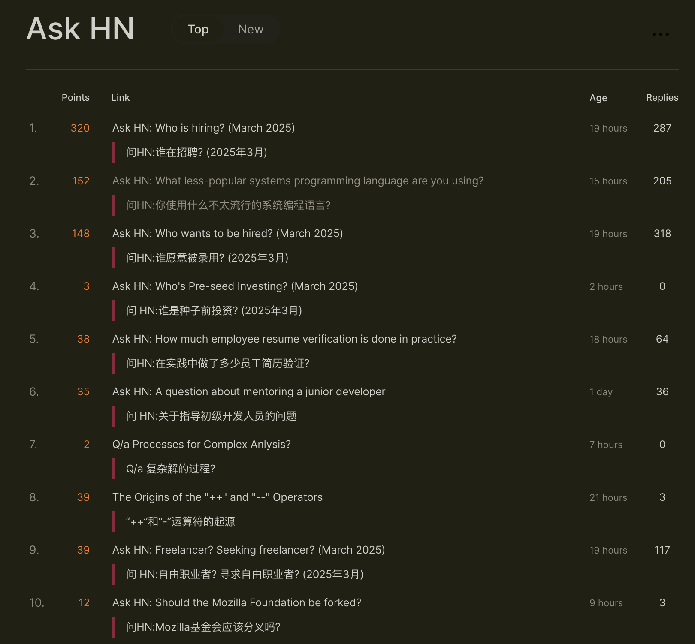
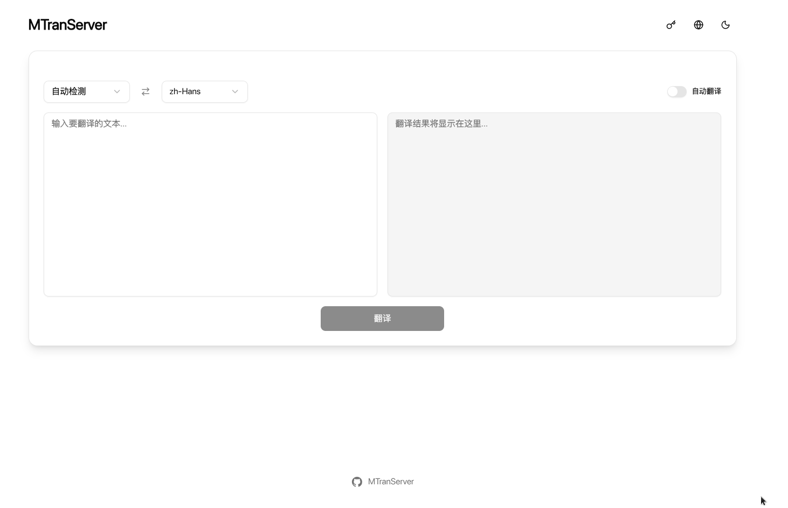
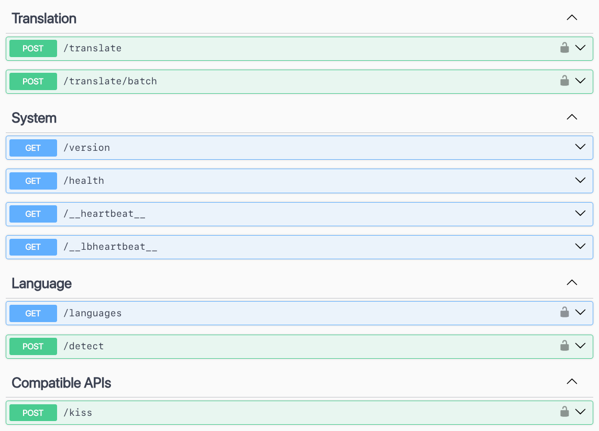

# MTranServer

[中文](../README.md) | [English](README_en.md) | [日本語](README_ja.md) | [Français](README_fr.md) | [Deutsch](README_de.md)

A free offline translation service that runs on your own computer. It is very fast ⚡, does not require a GPU, and can also use one for acceleration. It supports multiple languages and works with browser and editor plugins. Speed and memory use depend on the computer, the languages, and the text length.

Suitable for everyday reading and getting the gist. Translations may be wrong; check important content against the original. It works best with software that shows the translation beside the source.

> After upgrading from v4 or earlier, the first use of a translation direction may need to prepare the translation files again.



## Online demo

> The model may not be the latest version.

| Website | TOKEN | Other endpoint | Provider |
| --- | --- | --- | --- |
| [ipacel.cc](https://MTranServer.ipacel.cc/ui/?token=__IpacEL_MT_API_TOKEN__) | `__IpacEL_MT_API_TOKEN__` | Immersive Translate: `https://MTranServer.ipacel.cc/imme?token=__IpacEL_MT_API_TOKEN__` | [@ApliNi](https://github.com/ApliNi) |

Thanks to community contributors for providing a trial service.

## Usage

For everyday use, install the desktop app. On a server, use Docker or the command line. v5 does not provide a standalone server executable.

### Desktop

Download the installer for your platform from [Releases](https://github.com/xxnuo/MTranServer/releases), then install and start it. The tray menu manages the service. The app includes a simple interface and API documentation.





### Command line

```bash
npx mtranserver@latest
```

`npx` can be replaced with `bunx`, `pnpx`, and similar tools. To keep it installed:

```bash
npm i -g mtranserver@latest
mtranserver
```

`npm` can be replaced with `bun`, `pnpm`, and similar tools. The first translation for a language direction downloads and prepares the files online, then reuses them. Try a short text first.

### Docker

The default image uses only the CPU. In an empty directory, create `compose.yml`:

```yml
services:
  mtranserver:
    image: xxnuo/mtranserver:latest
    container_name: mtranserver
    restart: unless-stopped
    ports:
      - "8989:8989"
    environment:
      - MT_HOST=0.0.0.0
      - MT_PORT=8989
      - MT_MODEL_DIR=/app/models
      - MT_CONFIG_DIR=/root/.config/mtran/server
      - MT_OFFLINE=false
      - MT_CPU_ONLY=true
      # - MT_API_TOKEN=your_secret_token_here
    volumes:
      - ./models:/app/models
      - ./config:/root/.config/mtran
```

```bash
docker pull xxnuo/mtranserver:latest
docker compose up -d
```

For a GPU, run the matching file from this repository. These configs use the host drivers and infer with WebGPU/Vulkan. They do not include CUDA or TensorRT:

```bash
docker compose -f compose.intel.yml up -d   # Intel, maps /dev/dri
docker compose -f compose.amd.yml up -d     # AMD, maps /dev/dri
docker compose -f compose.nvidia.yml up -d  # NVIDIA Container Toolkit
```

GPU configs choose a backend from measurements and keep a CPU fallback.

### Upgrades and offline use

1. Before upgrading, keep the existing config and model directories.
2. Stay online after upgrading. Translate once in each direction you need, and wait until the files are ready.
3. Then enable offline mode in settings, or pass `--offline` / `MT_OFFLINE=true`. Offline mode can only use directions that are already prepared.
4. When moving to another machine or migrating Docker, take both the config and model directories.

The Docker example stores them as `config` and `models` in the current directory. For an offline deployment, prepare the files online first, set `MT_OFFLINE` to `true`, and restart.

## Integration

### Browser plugins

Enter the addresses below in the plugin. If requests time out or the machine struggles, lower the concurrency and the length of each request.

| Endpoint | Method | Plugin | Address |
| --- | --- | --- | --- |
| `/imme` | POST | [Immersive Translate](https://immersivetranslate.com/) | `http://localhost:8989/imme` |
| `/kiss` | POST | [Kiss Translator](https://github.com/fishjar/kiss-translator) | `http://localhost:8989/kiss` |
| `/deepl` | POST | Clients that support DeepL API v2 | `http://localhost:8989/deepl` |
| `/deeplx` | POST | Clients that support DeepLX | `http://localhost:8989/deeplx` |
| `/hcfy` | POST | [hcfy](https://github.com/Selection-Translator/crx-selection-translate) | `http://localhost:8989/hcfy` |
| `/google/language/translate/v2` | POST | Clients that support Google Translate API v2 | `http://localhost:8989/google/language/translate/v2` |
| `/google/translate_a/single` | GET | Clients that support Google web translation | `http://localhost:8989/google/translate_a/single` |

When `MT_API_TOKEN` is set:

| Plugin | What to enter |
| --- | --- |
| Immersive Translate | Change the URL to `http://localhost:8989/imme?token=your_token` |
| Kiss Translator | Keep the `/kiss` URL and put the token in `KEY` |
| DeepL | `DeepL-Auth-Key` or `Bearer` |
| DeepLX, hcfy | `token` query parameter, or `Bearer` |
| Google Translate API | `key` parameter, or `Bearer` |

### Other projects

- [MTranCode](https://github.com/xxnuo/MTranCode): comment translation for VS Code, Cursor, and similar editors. Search the marketplace for `MTranCode`. It requests `http://localhost:8989` by default. Based on [vscode-comment-translate](https://github.com/intellism/vscode-comment-translate).
- [MTranBrowser](https://github.com/xxnuo/MTranBrowser): in development.
- The npm package `mtranserver` can also be used as a library. See the type declarations in the published package.

Pull requests that add related projects are welcome.

### Common options

```bash
mtranserver --help
mtranserver --host 127.0.0.1 --port 8080
mtranserver --download en_zh zh_en
mtranserver --languages
mtranserver --offline
```

| Option | Description |
| --- | --- |
| `--host` / `--port` | Listen address and port, default `0.0.0.0:8989` |
| `--ui` / `--no-ui` | Enable or disable the web UI, enabled by default |
| `--offline` | Use only translation files that are already prepared |
| `--download <directions...>` | Download and prepare, for example `en_zh zh_en` |
| `--languages [filter]` | List directions available for download |
| `--worker-idle-timeout <seconds>` | Release the engine after it is idle, default 60 |
| `--cache-size <count>` | Cache recent translations, default 1000; `0` disables it |
| `--fast` / `--no-fast` | Enable fast mode, default off; may increase mistranslations |
| `--api-token <token>` | API access token |

Environment variables and the remaining options are in [API_en.md](API_en.md), or run `mtranserver --help`.

## Performance

Same-run CPU comparison, for reference. Lower ms and higher req/s are better.

| Direction | Input | Concurrency | Default | Fast | [LinguaSpark](https://github.com/LinguaSpark/server) |
| --- | --- | --- | --- | --- | --- |
| English → Chinese | Short | 1 | 8.8 ms | 7.2 ms | 10.7 ms |
| English → Chinese | Paragraph | 1 | 32.5 ms | 28.1 ms | 46.7 ms |
| Chinese → English | Short | 1 | 11.8 ms | 6.5 ms | 9.9 ms |
| Chinese → English | Paragraph | 1 | 53.0 ms | 29.0 ms | 48.6 ms |
| English → Chinese | Long text (32 sentences) | 1 | 164.2 ms | 120.8 ms | 482.2 ms |
| Chinese → English | Long text (32 sentences) | 1 | 459.1 ms | 159.1 ms | 580.7 ms |
| English → Chinese | Short | 8 | 273 req/s | 401 req/s | 491 req/s |
| Chinese → English | Short | 8 | 155 req/s | 453 req/s | 497 req/s |

With both translation directions loaded: Default about 619 MiB, Fast 650 MiB, LinguaSpark 190 MiB.

Long texts use sentence concurrency; [paired HTTP tests](benchmarks/plain-inference-concurrency.json) showed 36%–60% lower latency per long-text request than before the optimization. Enable Fast with `--fast`; it is off by default and can increase mistranslations. [Examples](../tests/fixtures/translation-quality-regressions.json).

## Similar projects

| Project | Memory | Speed | Notes |
| --- | --- | --- | --- |
| [NLLB](https://github.com/facebookresearch/fairseq/tree/nllb) | Very high | Slow | The Android port [RTranslator](https://github.com/niedev/RTranslator) still uses a lot of memory |
| [LibreTranslate](https://github.com/LibreTranslate/LibreTranslate) | Very high | Medium | [Community data](https://community.libretranslate.com/t/performance-benchmark-data/486): about 3 sentences/s on a mid-range CPU, about 15–20 on a high-end CPU |
| [OPUS-MT](https://github.com/Helsinki-NLP/Opus-MT) | High | Fast | [CTranslate2 benchmarks](https://github.com/OpenNMT/CTranslate2#benchmarks) |
| Other large models | Extremely high | Very slow | Good quality and high hardware requirements; vLLM is commonly used for high concurrency |
| This project | Depends on models and concurrency | Extremely fast | CPU translation, cache disabled |

## More

Advanced configuration is in [API_en.md](API_en.md) and in the API documentation after startup.

[](https://www.star-history.com/#xxnuo/MTranServer&Timeline)

## Thanks

[Bergamot Project](https://browser.mt/) for the inspiration for local translation.

[ONNX Runtime](https://github.com/microsoft/onnxruntime) for the translation runtime.

[Mozilla](https://github.com/mozilla) for the [models](https://github.com/mozilla/firefox-translations-models).
