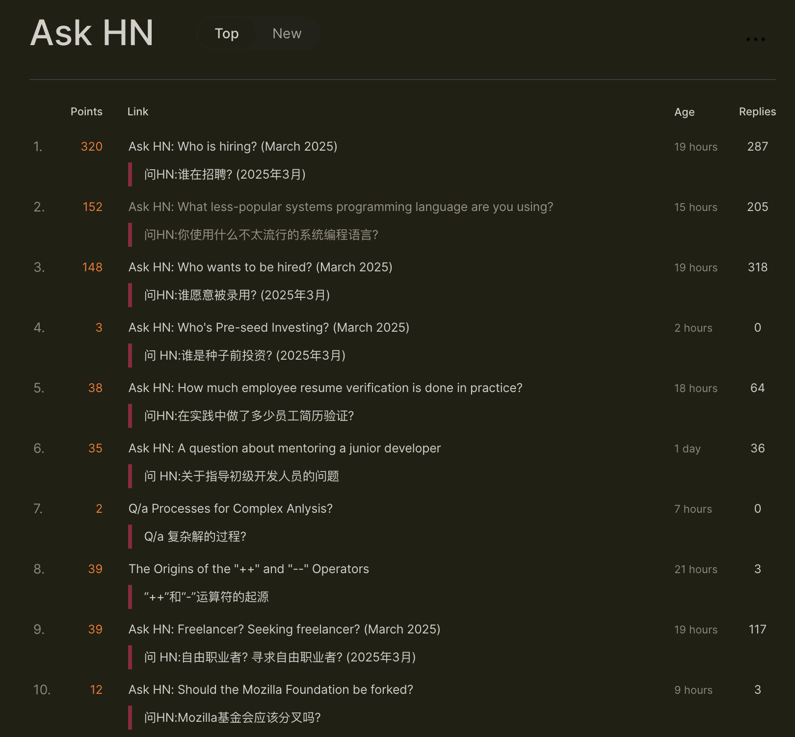
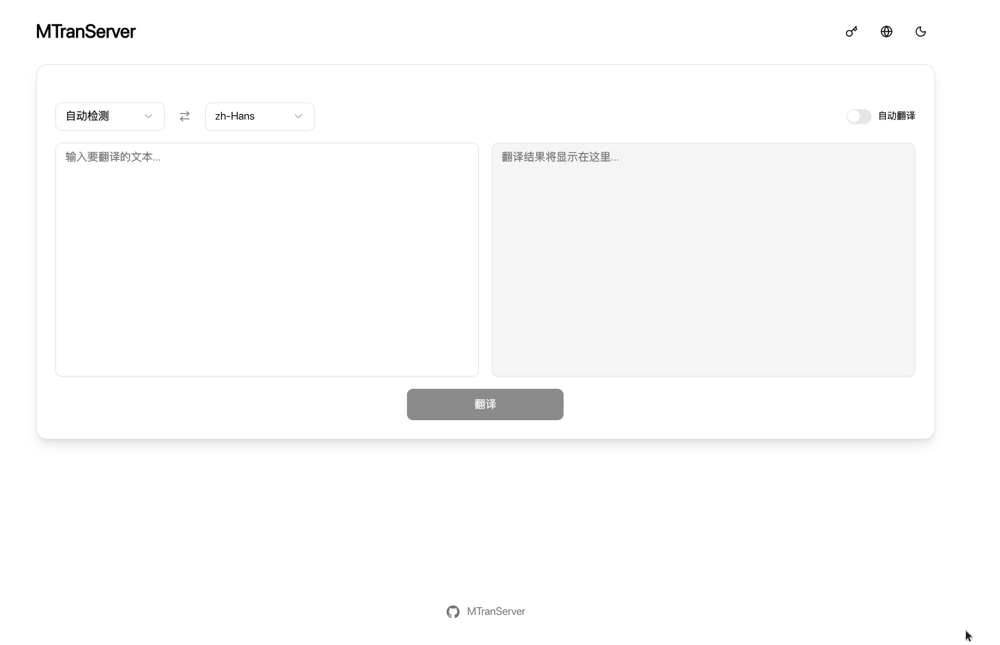
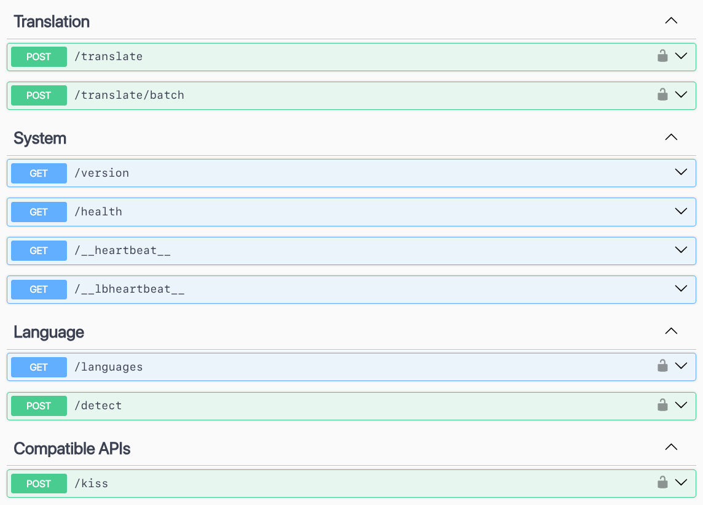

# MTranServer

[中文](../README.md) | [English](README_en.md) | [日本語](README_ja.md) | [Français](README_fr.md) | [Deutsch](README_de.md)

Service de traduction hors ligne gratuit, exécuté sur votre propre ordinateur. Il est très rapide ⚡, ne nécessite pas de carte graphique et peut aussi l'utiliser pour accélérer. Il prend en charge plusieurs langues et s'utilise avec des extensions de navigateur et d'éditeur. La vitesse et la mémoire dépendent de l'ordinateur, des langues et de la longueur du texte.

Adapté à la lecture quotidienne et à la compréhension du sens général. La traduction peut contenir des erreurs ; vérifiez les contenus importants avec le texte original. Il est recommandé de l'utiliser avec un logiciel qui affiche la traduction en regard de l'original.

> Après une mise à niveau depuis la v4 ou une version antérieure, la première utilisation d'un sens de traduction peut nécessiter de préparer à nouveau les fichiers.



## Essai en ligne

> Le modèle n'est peut-être pas la dernière version.

| Site | TOKEN | Autre interface | Fournisseur |
| --- | --- | --- | --- |
| [ipacel.cc](https://MTranServer.ipacel.cc/ui/?token=__IpacEL_MT_API_TOKEN__) | `__IpacEL_MT_API_TOKEN__` | Immersive Translate : `https://MTranServer.ipacel.cc/imme?token=__IpacEL_MT_API_TOKEN__` | [@ApliNi](https://github.com/ApliNi) |

Merci aux contributeurs de la communauté pour ce service d'essai.

## Utilisation

Pour un usage quotidien, installez l'application de bureau. Sur un serveur, utilisez Docker ou la ligne de commande. La v5 ne fournit pas d'exécutable serveur autonome.

### Application de bureau

Téléchargez l'installateur de votre plateforme depuis [Releases](https://github.com/xxnuo/MTranServer/releases), installez-le et lancez-le. Le menu de la barre système permet de gérer le service. L'application inclut une interface simple et la documentation de l'API.





### Ligne de commande

```bash
npx mtranserver@latest
```

`npx` peut être remplacé par `bunx`, `pnpx`, etc. Pour une installation permanente :

```bash
npm i -g mtranserver@latest
mtranserver
```

`npm` peut être remplacé par `bun`, `pnpm`, etc. La première traduction d'un sens de langue télécharge et prépare les fichiers en ligne, puis les réutilise. Essayez d'abord un court texte.

### Docker

L'image par défaut n'utilise que le CPU. Dans un répertoire vide, créez `compose.yml` :

```yml
services:
  mtranserver:
    image: xxnuo/mtranserver:latest
    container_name: mtranserver
    restart: unless-stopped
    ports:
      - "8989:8989"
    environment:
      - MT_HOST=0.0.0.0
      - MT_PORT=8989
      - MT_MODEL_DIR=/app/models
      - MT_CONFIG_DIR=/root/.config/mtran/server
      - MT_OFFLINE=false
      - MT_CPU_ONLY=true
      # - MT_API_TOKEN=your_secret_token_here
    volumes:
      - ./models:/app/models
      - ./config:/root/.config/mtran
```

```bash
docker pull xxnuo/mtranserver:latest
docker compose up -d
```

Pour un GPU, exécutez le fichier correspondant dans ce dépôt. Ces configurations dépendent des pilotes de l'hôte et infèrent avec WebGPU/Vulkan. Elles n'incluent ni CUDA ni TensorRT :

```bash
docker compose -f compose.intel.yml up -d   # Intel, monte /dev/dri
docker compose -f compose.amd.yml up -d     # AMD, monte /dev/dri
docker compose -f compose.nvidia.yml up -d  # NVIDIA Container Toolkit
```

Les configurations GPU choisissent le moteur d'après des mesures et conservent un repli sur le CPU.

### Mise à niveau et mode hors ligne

1. Avant la mise à niveau, conservez les répertoires de configuration et de modèles existants.
2. Restez en ligne après la mise à niveau. Essayez une fois chaque sens dont vous avez besoin et attendez la fin de la préparation.
3. Activez ensuite le mode hors ligne dans les réglages, ou ajoutez `--offline` / `MT_OFFLINE=true`. Hors ligne, seuls les sens déjà préparés sont utilisables.
4. Pour changer de machine ou migrer Docker, emportez les deux répertoires, configuration et modèles.

L'exemple Docker les place dans `config` et `models` du répertoire courant. Pour un déploiement hors ligne, préparez d'abord les fichiers en ligne, passez `MT_OFFLINE` à `true`, puis redémarrez.

## Intégration

### Extensions de navigateur

Saisissez les adresses ci-dessous dans l'extension. En cas de délai dépassé ou si la machine est trop sollicitée, réduisez la concurrence et la longueur de chaque requête.

| Interface | Méthode | Extension | Adresse |
| --- | --- | --- | --- |
| `/imme` | POST | [Immersive Translate](https://immersivetranslate.com/) | `http://localhost:8989/imme` |
| `/kiss` | POST | [Kiss Translator](https://github.com/fishjar/kiss-translator) | `http://localhost:8989/kiss` |
| `/deepl` | POST | Clients compatibles avec l'API DeepL v2 | `http://localhost:8989/deepl` |
| `/deeplx` | POST | Clients compatibles DeepLX | `http://localhost:8989/deeplx` |
| `/hcfy` | POST | [hcfy](https://github.com/Selection-Translator/crx-selection-translate) | `http://localhost:8989/hcfy` |
| `/google/language/translate/v2` | POST | Clients compatibles avec l'API Google Translate v2 | `http://localhost:8989/google/language/translate/v2` |
| `/google/translate_a/single` | GET | Clients compatibles avec la traduction web Google | `http://localhost:8989/google/translate_a/single` |

Lorsque `MT_API_TOKEN` est défini :

| Extension | Valeur à saisir |
| --- | --- |
| Immersive Translate | Remplacez l'URL par `http://localhost:8989/imme?token=votre_jeton` |
| Kiss Translator | Gardez l'URL `/kiss` et mettez le jeton dans `KEY` |
| DeepL | `DeepL-Auth-Key` ou `Bearer` |
| DeepLX, hcfy | Paramètre `token` de l'URL, ou `Bearer` |
| API Google Translate | Paramètre `key`, ou `Bearer` |

### Autres projets

- [MTranCode](https://github.com/xxnuo/MTranCode) : extension de traduction des commentaires pour VS Code, Cursor et les éditeurs similaires. Cherchez `MTranCode` dans la boutique. Elle interroge `http://localhost:8989` par défaut. Basée sur [vscode-comment-translate](https://github.com/intellism/vscode-comment-translate).
- [MTranBrowser](https://github.com/xxnuo/MTranBrowser) : en cours de développement.
- Le paquet npm `mtranserver` peut aussi servir de bibliothèque. Les types se trouvent dans les déclarations du paquet publié.

Les PR qui ajoutent un projet dérivé sont les bienvenues.

### Options courantes

```bash
mtranserver --help
mtranserver --host 127.0.0.1 --port 8080
mtranserver --download en_zh zh_en
mtranserver --languages
mtranserver --offline
```

| Option | Description |
| --- | --- |
| `--host` / `--port` | Adresse et port d'écoute, par défaut `0.0.0.0:8989` |
| `--ui` / `--no-ui` | Active ou désactive l'interface web, activée par défaut |
| `--offline` | Utilise seulement les fichiers de traduction déjà préparés |
| `--download <sens...>` | Télécharge et prépare, par exemple `en_zh zh_en` |
| `--languages [filtre]` | Liste les sens téléchargeables |
| `--worker-idle-timeout <secondes>` | Libère le moteur après inactivité, 60 par défaut |
| `--cache-size <nombre>` | Met en cache les traductions récentes, 1000 par défaut ; `0` le désactive |
| `--fast` / `--no-fast` | Activer fast, désactivé par défaut ; peut augmenter les erreurs |
| `--api-token <jeton>` | Jeton d'accès à l'API |

Les variables d'environnement et les autres options sont dans [API_fr.md](API_fr.md), ou exécutez `mtranserver --help`.

## Performances

Cache désactivé. Médiane de trois essais :

| Sens | Entrée (caractères) | Moteur | Concurrence | Moyenne (ms) | Débit (req/s) |
| --- | --- | --- | --- | --- | --- |
| Anglais → chinois | Courte 49–94 | CPU / 6 | 4 | 35.6 | 108.33 |
| Anglais → chinois | Paragraphe 234–344 | CPU / 6 | 1 | 27.7 | 36.31 |
| Allemand → anglais | Courte 50–113 | CPU / 5 | 4 | 39.7 | 96.51 |
| Allemand → anglais | Paragraphe 232–395 | CPU / 5 | 1 | 33.4 | 30.00 |

| Sens | Premier chargement et traduction (s) | Mémoire maximale (MiB) | Modèle (MiB) |
| --- | --- | --- | --- |
| Anglais → chinois | 33.47 | 391.7 | 118.8 |
| Allemand → anglais | 26.44 | 345.1 | 71.9 |

## Mode fast

Désactivé par défaut. Activation : `mtranserver --fast` ou `MT_FAST=true mtranserver` ; désactivation : `--no-fast`. Bibliothèque : `new MTran({ fast: true })`. Fast réduit les calculs de la couche de sortie avec une liste lexicale de candidats, mais peut augmenter les erreurs de traduction. Sans lexique, le mode original est utilisé. Le premier appel après un changement peut nécessiter une nouvelle conversion du modèle. Les alias `--lexical-shortlist` et `MT_LEXICAL_SHORTLIST` restent disponibles.

### Fast et LinguaSpark sur la même machine

Latence moyenne des requêtes séquentielles (ms, moins est mieux) :

| Direction / entrée | Original | Fast | [LinguaSpark](https://github.com/LinguaSpark/server) |
| --- | --- | --- | --- |
| EN→ZH court | 16.87 | 8.11 | 14.54 |
| EN→ZH paragraphe | 55.40 | 36.29 | 56.97 |
| ZH→EN court | 34.68 | 11.18 | 18.89 |
| ZH→EN paragraphe | 121.05 | 27.15 | 59.43 |

Débit des textes courts avec 8 requêtes simultanées (requêtes/s, plus est mieux) :

| Direction / entrée | Original | Fast | [LinguaSpark](https://github.com/LinguaSpark/server) |
| --- | --- | --- | --- |
| EN→ZH | 70.0 | 103.7 | 319.6 |
| ZH→EN | 37.9 | 138.0 | 293.3 |

RSS du processus après la charge avec les deux directions chargées (médiane de trois tours) : Original **542.4 MiB**, Fast **575.9 MiB**, LinguaSpark **190.4 MiB**. Il ne s’agit pas du pic mémoire pendant la conversion initiale.

2026-11-11, Intel Core i5-14400, Linux x64, limité aux CPU 0–15. Mêmes modèles Firefox EN/ZH et mêmes textes, cache désactivé. MTranServer sélectionne automatiquement les threads CPU et la concurrence ; LinguaSpark utilise 16 workers (moteur `269605c`). Un seul moteur tourne à la fois, sur trois tours dont l’ordre change, après préchauffage des 25 textes. Les tableaux donnent la médiane des moyennes ou débits des trois tours, hors démarrage, conversion et préchauffage. Chaque direction comprend 10 textes courts ; 3 paragraphes EN→ZH et 2 ZH→EN. Répétition 3 fois par tour en séquentiel, 24 fois en parallèle. Les anciens tableaux ci-dessus proviennent d’une autre mesure et ne sont pas directement comparables.

Fast et LinguaSpark peuvent introduire des erreurs de terminologie, de noms de lieux et de syntaxe ; voir [25 comparaisons de qualité](../tests/fixtures/translation-quality-regressions.json). Ces régressions sélectionnées ne mesurent pas le taux global d’erreur.

Méthode et données brutes: [Résultats bruts](benchmarks/fast-linguaspark-2026-11-11.json) · [Textes](benchmarks/fast-corpus.json) · [Script de mesure](../scripts/benchmark-engines.py).

## Projets similaires

| Projet | Mémoire | Vitesse | Remarque |
| --- | --- | --- | --- |
| [NLLB](https://github.com/facebookresearch/fairseq/tree/nllb) | Très élevée | Lente | Le portage Android [RTranslator](https://github.com/niedev/RTranslator) consomme encore beaucoup de mémoire |
| [LibreTranslate](https://github.com/LibreTranslate/LibreTranslate) | Très élevée | Moyenne | [Données de la communauté](https://community.libretranslate.com/t/performance-benchmark-data/486) : environ 3 phrases/s sur un CPU milieu de gamme, 15–20 sur un CPU haut de gamme |
| [OPUS-MT](https://github.com/Helsinki-NLP/Opus-MT) | Élevée | Rapide | [Mesures CTranslate2](https://github.com/OpenNMT/CTranslate2#benchmarks) |
| Autres grands modèles | Extrêmement élevée | Très lente | Bonne qualité, matériel exigeant ; vLLM est courant pour une forte concurrence |
| Ce projet | Environ 392 MiB au maximum pour l'anglais vers le chinois | Extrêmement rapide | Traduction sur CPU, cache désactivé |

## Pour aller plus loin

La configuration avancée se trouve dans [API_fr.md](API_fr.md) et dans la documentation de l'API après le démarrage.

[](https://www.star-history.com/#xxnuo/MTranServer&Timeline)

## Thanks

[Bergamot Project](https://browser.mt/) for the inspiration for local translation.

[ONNX Runtime](https://github.com/microsoft/onnxruntime) for the translation runtime.

[Mozilla](https://github.com/mozilla) for the [models](https://github.com/mozilla/firefox-translations-models).
