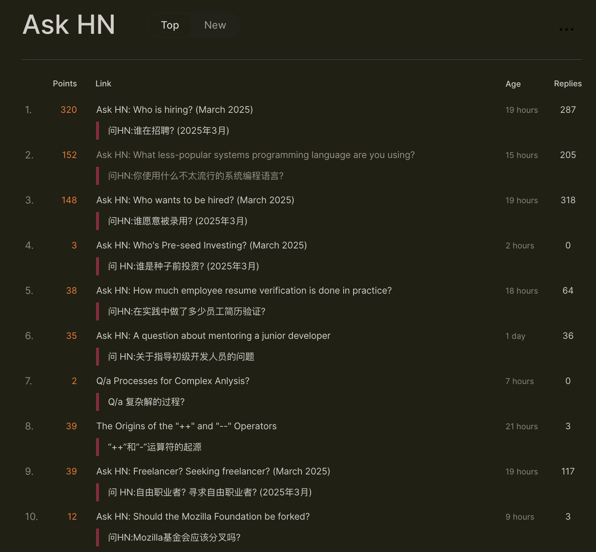
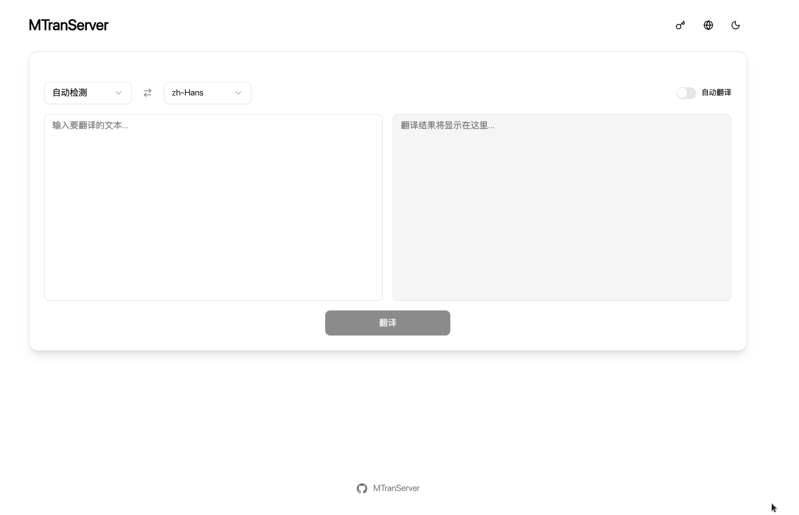
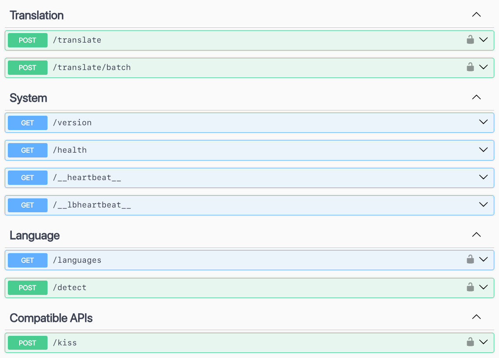

# MTranServer

[中文](../README.md) | [English](README_en.md) | [日本語](README_ja.md) | [Français](README_fr.md) | [Deutsch](README_de.md)

自分のパソコンで動く無料のオフライン翻訳サービスです。速度は非常に速く⚡、GPU は不要です（GPU 加速にも対応します）。複数の言語に対応し、ブラウザーやエディターのプラグインと組み合わせて使えます。速度とメモリ使用量は、パソコン、言語、テキストの長さによって変わります。

日常の読書や大意の把握に向いています。翻訳結果には誤りがあることがあるため、重要な内容は原文と照合してください。原文と訳文を対照表示できるソフトとの併用を推奨します。

> v4 以前からアップグレードした場合、翻訳方向を初めて使うときに翻訳ファイルの再準備が必要になることがあります。



## オンライン試用

> 最新版のモデルではない場合があります。

| サイト | TOKEN | その他のエンドポイント | 提供者 |
| --- | --- | --- | --- |
| [ipacel.cc](https://MTranServer.ipacel.cc/ui/?token=__IpacEL_MT_API_TOKEN__) | `__IpacEL_MT_API_TOKEN__` | 没入型翻訳: `https://MTranServer.ipacel.cc/imme?token=__IpacEL_MT_API_TOKEN__` | [@ApliNi](https://github.com/ApliNi) |

試用サービスを提供してくださったコミュニティの貢献者に感謝します。

## 使い方

日常利用にはデスクトップ版を推奨します。サーバーでは Docker またはコマンドラインを使います。v5 にはサーバー用の単一実行ファイルはありません。

### デスクトップ版

[Releases](https://github.com/xxnuo/MTranServer/releases) から各プラットフォームのインストーラーをダウンロードし、インストールして起動します。トレイメニューでサービスを管理できます。簡単な画面と API ドキュメントが付属します。





### コマンドライン

```bash
npx mtranserver@latest
```

`npx` は `bunx` や `pnpx` などに置き換えられます。常駐させる場合:

```bash
npm i -g mtranserver@latest
mtranserver
```

`npm` は `bun` や `pnpm` などに置き換えられます。ある翻訳方向を初めて使うときは、必要なファイルをネット経由でダウンロードして準備し、その後は再利用します。最初は短い文章で動作を確認してください。

### Docker

既定のイメージは CPU のみを使います。空のディレクトリに `compose.yml` を作成します。

```yml
services:
  mtranserver:
    image: xxnuo/mtranserver:latest
    container_name: mtranserver
    restart: unless-stopped
    ports:
      - "8989:8989"
    environment:
      - MT_HOST=0.0.0.0
      - MT_PORT=8989
      - MT_MODEL_DIR=/app/models
      - MT_CONFIG_DIR=/root/.config/mtran/server
      - MT_OFFLINE=false
      - MT_CPU_ONLY=true
      # - MT_API_TOKEN=your_secret_token_here
    volumes:
      - ./models:/app/models
      - ./config:/root/.config/mtran
```

```bash
docker pull xxnuo/mtranserver:latest
docker compose up -d
```

GPU を使う場合は、このリポジトリのディレクトリで対応する設定を実行します。ホストのドライバーに依存し、WebGPU/Vulkan で推論します。CUDA/TensorRT は含みません。

```bash
docker compose -f compose.intel.yml up -d   # Intel、/dev/dri をマッピング
docker compose -f compose.amd.yml up -d     # AMD、/dev/dri をマッピング
docker compose -f compose.nvidia.yml up -d  # NVIDIA Container Toolkit
```

GPU 設定は実測に基づいてバックエンドを選び、CPU へのフォールバックを残します。

### アップグレードとオフライン

1. アップグレード前に、既存の設定ディレクトリとモデルディレクトリを残します。
2. アップグレード後はネットに接続したまま、使う翻訳方向をそれぞれ一度試し、ファイルの準備が終わるまで待ちます。
3. 準備ができたら、設定でオフラインモードを有効にするか、`--offline` / `MT_OFFLINE=true` を指定します。オフラインでは、準備済みの方向しか使えません。
4. 別のマシンへ移すときや Docker を移行するときは、設定とモデルの両方を持ち運びます。

上の Docker 例では、これらをカレントディレクトリの `config` と `models` に保存します。オフラインで配備する前に、まずオンラインで準備し、`MT_OFFLINE` を `true` にして再起動します。

## 連携

### ブラウザー拡張

次のアドレスを拡張機能に入力します。タイムアウトしたりマシンの負荷が高い場合は、同時実行数と 1 回の長さを下げてください。

| エンドポイント | メソッド | 拡張機能 | アドレス |
| --- | --- | --- | --- |
| `/imme` | POST | [没入型翻訳](https://immersivetranslate.com/) | `http://localhost:8989/imme` |
| `/kiss` | POST | [簡潔翻訳](https://github.com/fishjar/kiss-translator) | `http://localhost:8989/kiss` |
| `/deepl` | POST | DeepL API v2 対応クライアント | `http://localhost:8989/deepl` |
| `/deeplx` | POST | DeepLX 対応クライアント | `http://localhost:8989/deeplx` |
| `/hcfy` | POST | [划词翻訳](https://github.com/Selection-Translator/crx-selection-translate) | `http://localhost:8989/hcfy` |
| `/google/language/translate/v2` | POST | Google Translate API v2 対応クライアント | `http://localhost:8989/google/language/translate/v2` |
| `/google/translate_a/single` | GET | Google ウェブ翻訳対応クライアント | `http://localhost:8989/google/translate_a/single` |

`MT_API_TOKEN` を設定している場合:

| 拡張機能 | 入力内容 |
| --- | --- |
| 没入型翻訳 | URL を `http://localhost:8989/imme?token=あなたのトークン` に変更 |
| 簡潔翻訳 | URL は `/kiss` のまま、`KEY` にトークンを入力 |
| DeepL | `DeepL-Auth-Key` または `Bearer` |
| DeepLX、划词翻訳 | URL の `token` パラメーター、または `Bearer` |
| Google Translate API | `key` パラメーター、または `Bearer` |

### その他のプロジェクト

- [MTranCode](https://github.com/xxnuo/MTranCode): VS Code や Cursor などのコメント翻訳拡張機能。マーケットプレースで `MTranCode` を検索します。既定では `http://localhost:8989` にリクエストします。[vscode-comment-translate](https://github.com/intellism/vscode-comment-translate) を基にしています。
- [MTranBrowser](https://github.com/xxnuo/MTranBrowser): 開発中。
- npm パッケージ `mtranserver` はライブラリとしても呼び出せます。型は公開パッケージの宣言ファイルを参照してください。

派生プロジェクトがあれば PR を歓迎します。ここに追加します。

### 主なオプション

```bash
mtranserver --help
mtranserver --host 127.0.0.1 --port 8080
mtranserver --download en_zh zh_en
mtranserver --languages
mtranserver --offline
```

| オプション | 説明 |
| --- | --- |
| `--host` / `--port` | 待ち受けアドレスとポート。既定は `0.0.0.0:8989` |
| `--ui` / `--no-ui` | Web UI のオン/オフ。既定はオン |
| `--offline` | 準備済みの翻訳ファイルだけを使う |
| `--download <方向...>` | ダウンロードして準備する。例: `en_zh zh_en` |
| `--languages [絞り込み]` | ダウンロードできる方向を一覧表示 |
| `--worker-idle-timeout <秒>` | アイドル後にエンジンを解放。既定は 60 |
| `--cache-size <件数>` | 最近の訳文をキャッシュ。既定は 1000。`0` で無効 |
| `--api-token <トークン>` | API アクセストークン |

環境変数とその他のオプションは [API_ja.md](API_ja.md) を参照するか、`mtranserver --help` を実行してください。

## 性能

キャッシュ無効。3 回の中央値:

| 方向 | 入力（文字数） | バックエンド | 同時実行 | 平均（ms） | スループット（回/秒） |
| --- | --- | --- | --- | --- | --- |
| 英 → 中 | 短文 49–94 | CPU / 6 | 4 | 35.6 | 108.33 |
| 英 → 中 | 段落 234–344 | CPU / 6 | 1 | 27.7 | 36.31 |
| 独 → 英 | 短文 50–113 | CPU / 5 | 4 | 39.7 | 96.51 |
| 独 → 英 | 段落 232–395 | CPU / 5 | 1 | 33.4 | 30.00 |

| 方向 | 初回読み込みと翻訳（秒） | ピークメモリ（MiB） | モデル（MiB） |
| --- | --- | --- | --- |
| 英 → 中 | 33.47 | 391.7 | 118.8 |
| 独 → 英 | 26.44 | 345.1 | 71.9 |

## 類似プロジェクト

| プロジェクト | メモリ | 速度 | 説明 |
| --- | --- | --- | --- |
| [NLLB](https://github.com/facebookresearch/fairseq/tree/nllb) | 非常に高い | 遅い | Android 移植の [RTranslator](https://github.com/niedev/RTranslator) もメモリを多く使います |
| [LibreTranslate](https://github.com/LibreTranslate/LibreTranslate) | 非常に高い | 中程度 | [コミュニティのデータ](https://community.libretranslate.com/t/performance-benchmark-data/486): 中位 CPU で約 3 文/秒、上位 CPU で約 15–20 文/秒 |
| [OPUS-MT](https://github.com/Helsinki-NLP/Opus-MT) | 高い | 速い | [CTranslate2 のベンチマーク](https://github.com/OpenNMT/CTranslate2#benchmarks) |
| その他の大規模モデル | 極めて高い | 非常に遅い | 品質は良いがハードウェア要件が高い。高同時実行には vLLM がよく使われます |
| 本プロジェクト | 英訳中のピーク約 392 MiB | 非常に速い | CPU 翻訳、キャッシュ無効 |

## その他

詳細な設定は [API_ja.md](API_ja.md) と、起動後の API ドキュメントを参照してください。

[](https://www.star-history.com/#xxnuo/MTranServer&Timeline)

## Thanks

[Bergamot Project](https://browser.mt/) for the inspiration for local translation.

[ONNX Runtime](https://github.com/microsoft/onnxruntime) for the translation runtime.

[Mozilla](https://github.com/mozilla) for the [models](https://github.com/mozilla/firefox-translations-models).
