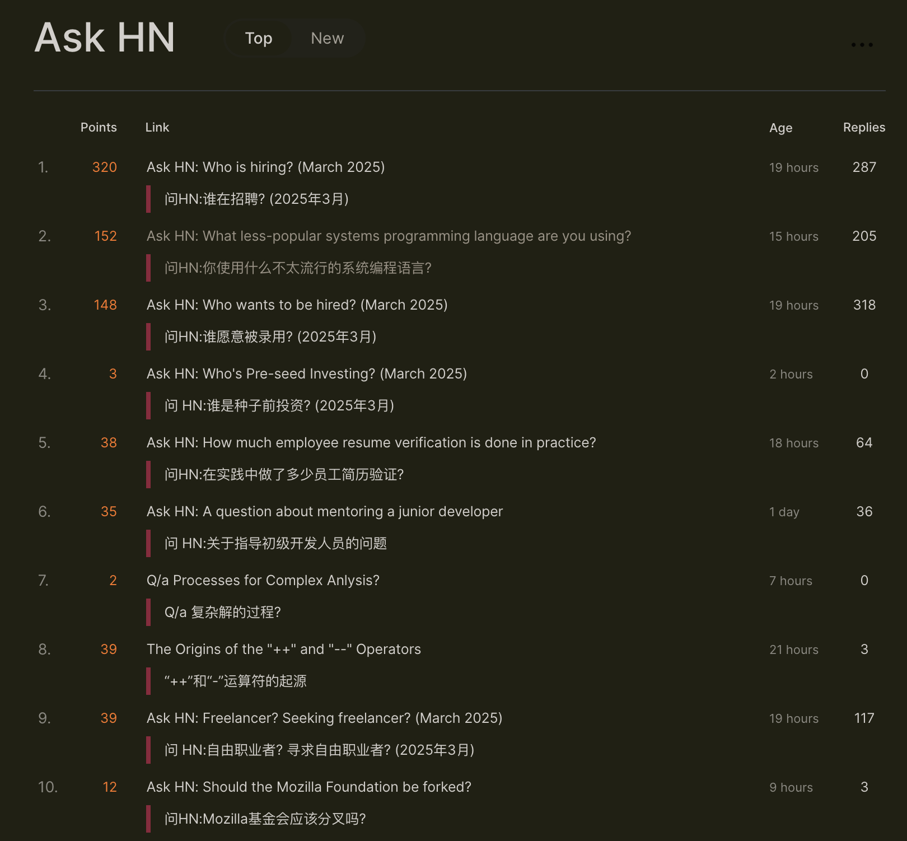
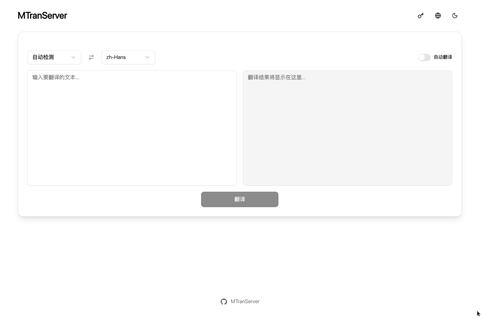
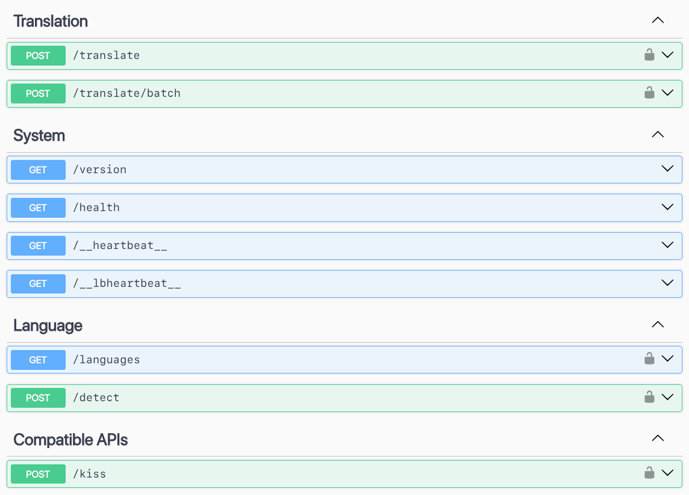

# MTranServer

[中文](../README.md) | [English](README_en.md) | [日本語](README_ja.md) | [Français](README_fr.md) | [Deutsch](README_de.md)

自分のパソコンで動作する無料のオフライン翻訳サービスです。グラフィックカードは不要です。複数の言語に対応し、ブラウザーやエディターのプラグインと組み合わせて使えます。速度とメモリ使用量は、パソコンの性能、言語、文章の長さによって変わります。

日常の読書や文章の大意をつかむために利用できます。誤訳の可能性があるため、重要な内容は原文と照らし合わせて確認してください。

> v5 では新しい翻訳エンジンを採用し、性能が大幅に向上しました。翻訳品質をさらに高めた新しい中国語・英語間の翻訳モデルも現在学習中です。更新後、各翻訳方向を初めて使う際に翻訳ファイルの再準備が必要になることがあります。完了までお待ちください。



## オンラインデモ

| ウェブサイト                                                                 | TOKEN                     | その他のインターフェース                                                       | 提供者                               |
| ---------------------------------------------------------------------------- | ------------------------- | ------------------------------------------------------------------------------ | ------------------------------------ |
| [ipacel.cc](https://MTranServer.ipacel.cc/ui/?token=__IpacEL_MT_API_TOKEN__) | `__IpacEL_MT_API_TOKEN__` | 没入型翻訳: `https://MTranServer.ipacel.cc/imme?token=__IpacEL_MT_API_TOKEN__` | [@ApliNi](https://github.com/ApliNi) |

ユーザーに試用サービスを提供してくださるコミュニティの貢献者に感謝します！

## 使用方法

デスクトップ版でワンクリック起動が可能になりました！Windows、Mac、Linux をサポートしています。

### デスクトップ版

#### 手動ダウンロード

[Releases](https://github.com/xxnuo/MTranServer/releases) から対応するプラットフォームの最新デスクトップ版をダウンロードし、直接インストールして起動するだけで使用できます。

デスクトップ版起動後、トレイメニューが作成され、メニューからサービスを便利に管理できます。

プログラムには簡易 UI とオンラインデバッグドキュメントが付属しています。

詳細な使用説明は [エコシステム](#エコシステム) にジャンプしてください。

プレビュー（最新版で更新あり）：





### サーバー版

一般の方には、インストールして起動できるデスクトップ版をお勧めします。サーバーでは Docker またはコマンドラインからのインストールを利用できます。v5 では現在、サーバー用の単一実行ファイルを提供していません。

#### クイックスタート

プログラマーの方はコマンドラインから直接サーバーを起動できます：

```bash
npx mtranserver@latest
```

> `npx` は `bunx`、`pnpx` など、好きなパッケージマネージャーに置き換え可能です。

> 各翻訳方向を初めて使う際には、必要なファイルをダウンロードして準備します。インターネットに接続したまま、完了までお待ちください。準備済みのファイルは次回以降も利用されます。まず短い文章を翻訳して動作を確認してください。初回や更新後の準備には、通常の翻訳より時間がかかります。

#### クイックインストール

```bash
npm i -g mtranserver@latest
```

> `npm` は `bun`、`pnpm` など、好きなパッケージマネージャーに置き換え可能です。

その後 `mtranserver` を起動してください。

#### Docker Compose デプロイ

空のディレクトリを作成し、以下の内容で `compose.yml` ファイルを作成します。

```yml
services:
  mtranserver:
    image: xxnuo/mtranserver:latest
    container_name: mtranserver
    restart: unless-stopped
    ports:
      - "8989:8989"
    environment:
      - MT_HOST=0.0.0.0
      - MT_PORT=8989
      - MT_MODEL_DIR=/app/models
      - MT_CONFIG_DIR=/root/.config/mtran/server
      - MT_OFFLINE=false
      # - MT_API_TOKEN=your_secret_token_here
    volumes:
      - ./models:/app/models
      - ./config:/root/.config/mtran
```

```bash
docker pull xxnuo/mtranserver:latest
docker compose up -d
```

### 更新とオフライン利用

1. 更新時には、既存の設定フォルダーと翻訳モデルフォルダーを残してください。
2. 更新後はインターネットに接続し、必要な翻訳方向をそれぞれ試して、準備の完了を待ってください。
3. その後、設定でオフラインモードを有効にしてから接続を切ります。オフラインでは準備済みの翻訳方向だけを利用できます。
4. 別のパソコンや Docker に移行する場合は、設定と翻訳モデルの両方のフォルダーを保存してください。モデルフォルダーだけでは不十分です。

上の Docker の例では、現在のディレクトリの `config` と `models` に保存されます。まずオンラインで準備を終え、`MT_OFFLINE` を `true` に変更して再起動してください。

## エコシステム

### IDE プラグイン

#### [MTranCode](https://github.com/xxnuo/MTranCode) コメント翻訳プラグイン

VS Code、Cursor、Augment などの VS Code 系 IDE をサポートしています。

拡張機能マーケットプレイスで **`MTranCode`** を検索するとコメント翻訳プラグインをインストールできます。

プラグインはデフォルトで `http://localhost:8989` のサーバーを呼び出してコメントやコードの翻訳を行います。設定で変更できます。

このプラグインは [vscode-comment-translate](https://github.com/intellism/vscode-comment-translate) を fork したものです。

### ブラウザ拡張

#### [MTranBrowser](https://github.com/xxnuo/MTranBrowser)

TODO: 開発中です。

> 派生プロジェクトを開発した場合は、PR を送ってください。エコシステムのプロジェクトに追加します。
>
> ちなみに、プロジェクトは npm パッケージとして公開されています。他のプログラムから簡単なライブラリインターフェースを直接呼び出して翻訳機能を実装できます。詳細は TypeScript 型定義をご確認ください。

## 互換インターフェース

サーバーは複数の翻訳プラグインの互換インターフェースを提供しています。

| インターフェース                | メソッド | 説明                                                        | 対応プラグイン                                                              |
| ------------------------------- | -------- | ----------------------------------------------------------- | --------------------------------------------------------------------------- |
| `/imme`                         | POST     | 没入型翻訳（Immersive Translate）プラグインインターフェース | [没入型翻訳](https://immersivetranslate.com/)                               |
| `/kiss`                         | POST     | Kiss Translator プラグインインターフェース                  | [Kiss Translator](https://github.com/fishjar/kiss-translator)               |
| `/deepl`                        | POST     | DeepL API v2 互換インターフェース                           | DeepL API 対応クライアント                                                  |
| `/deeplx`                       | POST     | DeepLX 互換インターフェース                                 | DeepLX API 対応クライアント                                                 |
| `/hcfy`                         | POST     | 划词翻译（Selection Translator）互換インターフェース        | [划词翻译](https://github.com/Selection-Translator/crx-selection-translate) |
| `/google/language/translate/v2` | POST     | Google Translate API v2 互換インターフェース                | Google Translate API 対応クライアント                                       |
| `/google/translate_a/single`    | GET      | Google translate_a/single 互換インターフェース              | Google ウェブ翻訳対応クライアント                                           |

**プラグイン設定説明：**

> 下の表のアドレスをプラグインの設定に入力してください。リクエスト頻度や同時翻訳数は、まず初期設定で試してください。タイムアウトやパソコンへの負荷が大きい場合は、設定値を下げてください。

| 名前                              | URL                                                  | プラグイン設定                                                                 |
| --------------------------------- | ---------------------------------------------------- | ------------------------------------------------------------------------------ |
| 没入型翻訳（パスワードなし）      | `http://localhost:8989/imme`                         | `カスタムAPI設定` - `API URL`                                                  |
| 没入型翻訳（パスワードあり）      | `http://localhost:8989/imme?token=your_token`        | 同上、URL 末尾の `your_token` をあなたの `MT_API_TOKEN` の値に変更してください |
| Kiss Translator（パスワードなし） | `http://localhost:8989/kiss`                         | `インターフェース設定` - `Custom` - `URL`                                      |
| Kiss Translator（パスワードあり） | `http://localhost:8989/kiss`                         | 同上、`KEY` に `your_token` を入力してください                                 |
| DeepL 互換                        | `http://localhost:8989/deepl`                        | `DeepL-Auth-Key` または `Bearer` 認証を使用                                    |
| DeepLX 互換                       | `http://localhost:8989/deeplx`                       | `token` パラメータまたは `Bearer` 認証をサポート                               |
| Google 互換                       | `http://localhost:8989/google/language/translate/v2` | `key` パラメータまたは `Bearer` 認証を使用                                     |
| 划词翻译                          | `http://localhost:8989/hcfy`                         | `token` パラメータまたは `Bearer` 認証をサポート                               |

**一般ユーザーは、表の内容に従ってプラグインの使用インターフェースアドレスを設定すれば使用できます。**

### コマンドライン引数

```bash
mtranserver --help

  --help                              ヘルプを表示
  --host <ip>                         待ち受けアドレス、初期値 0.0.0.0
  --port <port>                       ポート、初期値 8989
  --ui / --no-ui                      Web UI を有効または無効にする
  --offline                           準備済みの翻訳ファイルを使用
  --worker-idle-timeout <seconds>      待機中の翻訳エンジンを解放、初期値 60 秒
  --cache-size <count>                最近の翻訳結果を保存、初期値 1000 件；0 で無効
  --download en_zh zh_en              指定した翻訳方向をダウンロードして準備
  --languages [filter]                利用可能な翻訳方向を表示

  mtranserver --host 127.0.0.1 --port 8080
  mtranserver --download en_zh zh_en
  mtranserver --offline
```

## 性能テスト（v5 ONNX）

MTranServer **5.1.0**、標準量子化 ONNX モデル、翻訳キャッシュ無効（`MT_CACHE_SIZE=0`）。処理数は 3 回の中央値です。参考値であり、機器、文章、システム負荷によって変わります。

| 翻訳方向 | 入力（文字数） | バックエンド / 推論スレッド | 同時リクエスト | 平均（ms） | P95（ms） | 処理数（件/秒） |
| --- | --- | --- | --- | --- | --- | --- |
| 英語 → 中国語 | 短文 49–94 | CPU / 6 | 1 | 11.5 | 16.6 | 86.51 |
| 英語 → 中国語 | 短文 49–94 | CPU / 6 | 4 | 35.6 | 50.8 | 108.33 |
| 英語 → 中国語 | 段落 234–344 | CPU / 6 | 1 | 27.7 | 35.0 | 36.31 |
| 中国語 → 英語 | 短文 14–28 | CPU / 7 | 1 | 20.2 | 28.3 | 48.61 |
| 中国語 → 英語 | 短文 14–28 | CPU / 7 | 4 | 68.2 | 89.1 | 56.19 |
| 中国語 → 英語 | 段落 65–104 | CPU / 7 | 1 | 62.5 | 85.7 | 15.52 |
| ドイツ語 → 英語 | 短文 50–113 | CPU / 5 | 1 | 12.6 | 17.7 | 83.02 |
| ドイツ語 → 英語 | 短文 50–113 | CPU / 5 | 4 | 39.7 | 51.5 | 96.51 |
| ドイツ語 → 英語 | 段落 232–395 | CPU / 5 | 1 | 33.4 | 43.4 | 30.00 |

| 翻訳方向 | 初回読み込み・バックエンド選択・翻訳（秒） | ウォームアップ後 RSS（MiB） | 最大 RSS（MiB） | ONNX モデル（MiB） |
| --- | --- | --- | --- | --- |
| 英語 → 中国語 | 33.47 | 364.3 | 391.7 | 118.8 |
| 中国語 → 英語 | 62.99 | 410.0 | 475.7 | 125.5 |
| ドイツ語 → 英語 | 26.44 | 319.3 | 345.1 | 71.9 |

### 公開済み 5.0.1 との同時期の比較

| 翻訳方向 | 入力 | 同時数 | 5.0.1（件/秒） | 5.1.0（件/秒） | 速度比 |
| --- | --- | --- | --- | --- | --- |
| 英語 → 中国語 | 短文 | 1 | 46.92 | 83.52 | 1.78× |
| 英語 → 中国語 | 短文 | 4 | 57.25 | 93.65 | 1.64× |
| 英語 → 中国語 | 段落 | 1 | 17.27 | 32.15 | 1.86× |
| 中国語 → 英語 | 短文 | 1 | 28.76 | 48.42 | 1.68× |
| 中国語 → 英語 | 短文 | 4 | 28.86 | 51.69 | 1.79× |
| 中国語 → 英語 | 段落 | 1 | 7.40 | 15.58 | 2.10× |
| ドイツ語 → 英語 | 短文 | 1 | 48.45 | 75.11 | 1.55× |
| ドイツ語 → 英語 | 短文 | 4 | 46.20 | 93.65 | 2.03× |
| ドイツ語 → 英語 | 段落 | 1 | 14.78 | 30.57 | 2.07× |

## 類似プロジェクト

旧版の比較記録に、現在の v5 の英中翻訳の実測値を追加しました。測定環境が異なるため、参考資料としてご覧ください。

| プロジェクト名                                                     | メモリ使用量 | 同時実行性能 | 翻訳品質   | 速度       | その他情報                                                                                                                                         |
| ------------------------------------------------------------------ | ------------ | ------------ | ---------- | ---------- | -------------------------------------------------------------------------------------------------------------------------------------------------- |
| [NLLB](https://github.com/facebookresearch/fairseq/tree/nllb)      | 非常に高い   | 悪い         | 普通       | 遅い       | Android 移植版の [RTranslator](https://github.com/niedev/RTranslator) は多くの最適化がありますが、それでもリソース使用量が高く、高速ではありません |
| [LibreTranslate](https://github.com/LibreTranslate/LibreTranslate) | 非常に高い   | 普通         | 普通       | 中程度     | ミドルレンジ CPU で毎秒 3 文、ハイエンド CPU で毎秒 15-20 文処理。[詳細](https://community.libretranslate.com/t/performance-benchmark-data/486)    |
| [OPUS-MT](https://github.com/Helsinki-NLP/Opus-MT)       | 高い         | 普通         | やや悪い   | 速い       | [性能テスト](https://github.com/OpenNMT/CTranslate2#benchmarks)                                                                                    |
| その他大規模モデル                                                 | 超高い       | 動的         | 非常に良い | 非常に遅い | ハードウェア要件が高い。高同時実行翻訳が必要な場合は、vllm フレームワークの使用をお勧めします。                                                    |
| 本プロジェクト（旧 Bergamot エンジン）                                                     | 低           | 高い         | 普通       | 極めて速い | リクエストあたり平均応答時間 50ms。                                                                                                                |
| 本プロジェクト（v5 ONNX、自動選択） | 392MiB (peak, EN-ZH) | 実測に基づく同時実行制限 | 未評価 | 86.51/s | 英中短文翻訳。CPU 6 スレッドを自動選択。条件は上記参照 |

> 旧版の行は、元の README の CPU・英中翻訳の簡易テストと非量子化版の比較を残しています。v5 の行は上記の実測値と標準量子化 ONNX モデルに基づきます。

> 50ms は旧 Bergamot エンジンの過去の記録であり、v5 ONNX Runtime の実測値ではありません。元の README には、具体的な機器、文章の長さ、サンプル数、キャッシュ設定の記録がありません。定性的な評価も旧版の記載を残したもので、現在の各プロジェクトを同一環境で測定した順位ではありません。

[元の記録](https://github.com/xxnuo/MTranServer/blob/1f05f8536940f825be205e3434fd7fe964c56a26/docs/README_ja.md)

# 高度な設定説明

[API_ja.md](API_ja.md) ファイルおよび起動後の API ドキュメントを参照してください。

## Star History

[](https://www.star-history.com/#xxnuo/MTranServer&Timeline)

## Thanks

[Bergamot Project](https://browser.mt/) for the inspiration for local translation.

[ONNX Runtime](https://github.com/microsoft/onnxruntime) for the translation runtime.

[Mozilla](https://github.com/mozilla) for the [models](https://github.com/mozilla/firefox-translations-models).
